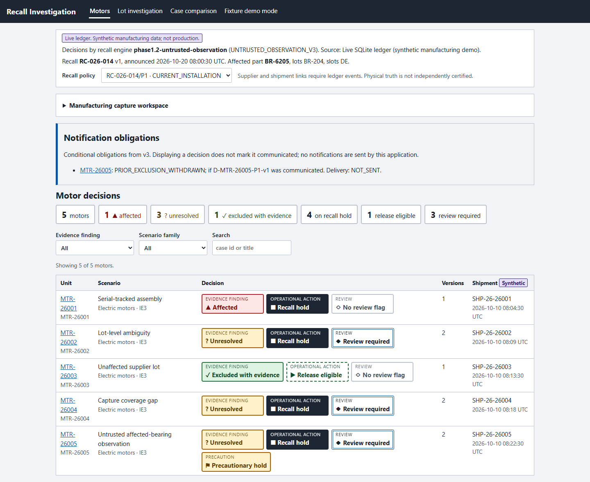
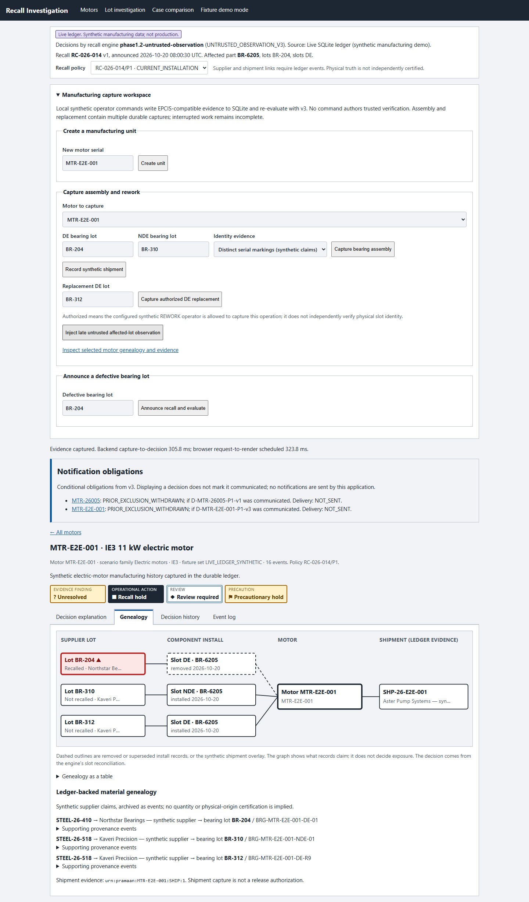
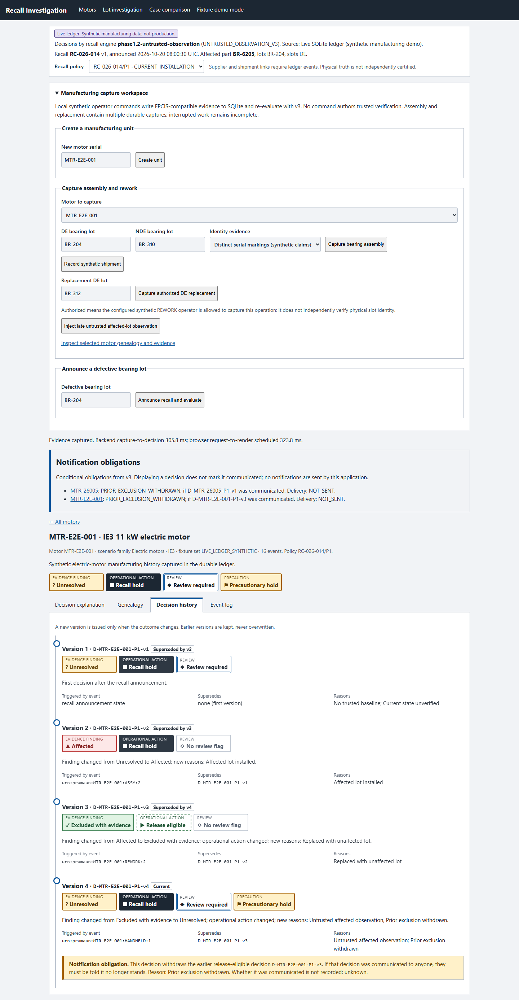
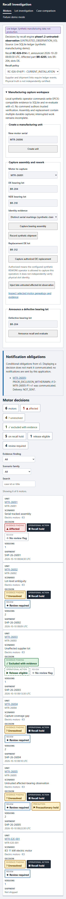

# Phase 3 unified Manufacturing PRAMAAN application

Date: 2026-10-21. Recommendation: **GO for draft review as a local synthetic demonstrator; REVISE before production or unattended operational use.** No merge or deployment has occurred. [Source audit and attribution](PHASE3_SOURCE_PROVENANCE.md) records the destination baseline and all four source pins. [Root installation instructions](../README.md) are authoritative; earlier phase READMEs describe their historical slices.

## Architecture and boundaries

The application runs one loopback Python process serving the built React UI and minimal JSON API. `BackendRecallDataSource` loads verified live snapshots and submits synthetic manufacturing commands. `FixtureSnapshotSource` remains an explicit read-only `?mode=fixtures` mode. Backend errors clear decisions and do not trigger a fixture fallback.

`application/service.py` authors synthetic event claims, encodes them as supported-profile EPCIS 2.0 documents, computes capture hashes and submits original bytes to the existing ledger. It never authors decision verdicts or trusted verification. `integration/pramaan_integration` validates source capabilities, references, source sequence, timestamps, EPCIS/native agreement, hashes and the complete selected watermark. SQLite retains original captures, producer timestamps, repository recordTime, local receipt, canonical event hashes and hash-chain links. `Ledger.decide` invokes the actual v3 engine and persists evidence-backed decision bundles and lifecycle history. The UI renders those decisions verbatim.

Three additive event types provide provenance claims: `MATERIAL_ALLOCATED` → `BEARING_MANUFACTURED` → existing `COMPONENT_INSTALLED`; `MOTOR_SHIPPED` references completed assembly closure. Cross-reference validation checks material supplier/raw-lot consistency and manufactured part/lot/serial identity. These custom ObjectEvent extensions are not claimed as a complete industry ontology or full EPCIS repository implementation. They are integrity-covered evidence; the v3 engine retains its own recall event semantics unchanged. Source configuration, sessions and coverage are provisioned explicitly by the local synthetic control plane. No missing physical evidence is inferred from a convenient default.

Each motor exposes native events, DE/NDE component claims, material provenance and a shipment only when a corresponding ledger event exists. Hashes establish content integrity, not independent physical truth or supplier certification. Shipment capture does not authorize release. Removed and superseded component links remain historical claims, not the engine's inferred current physical state.

## Local API

| Method / route | Purpose |
| --- | --- |
| `GET /api/snapshot` | Verified fleet, genealogy, current decisions, histories, comparison and obligations |
| `GET /api/motors` | Motors with native evidence and provenance |
| `GET /api/motors/{serial}/genealogy` | Component, material and shipment evidence |
| `GET /api/motors/{serial}/provenance` | Archived capture hash, receipt time, wire event and chain hash |
| `GET /api/motors/{serial}/decisions` | Actual decisions and history under the active policy |
| `GET /api/lots/{lot}/investigation` | Matching historical component claims with actual fleet decisions |
| `GET /api/notifications` | Conditional notification obligations; never marked delivered by viewing |
| `GET /api/session` | Process-local anti-CSRF token for demo commands |
| `POST /api/units` | Register a distinct motor; creates no empty-state evidence |
| `POST /api/units/{serial}/assemble` | Synthetic build, raw-lot allocation, bearing manufacture and DE/NDE installation |
| `POST /api/units/{serial}/ship` | Record an assembly-linked synthetic shipment |
| `POST /api/recalls` | Announce one immutable defective-lot recall scope |
| `POST /api/units/{serial}/replace` | Authorized synthetic REWORK removal, manufacture, replacement and closure |
| `POST /api/units/{serial}/observe` | Late, explicitly untrusted affected-bearing observation |

Commands require a local session token and same-origin Origin when present; requests are serialized within the process. SQLite capture and decision operations retain their existing transaction boundaries. No external notifications, production authentication, generic trusted-verifier endpoint, UI verdict calculation or network listener beyond loopback is implemented.

## Repeatable demonstration

Run `app.py --seed-demo` and open the local URL. The five seeded motor serials have distinct bearing identities and ledger-backed supplier/material/shipment claims:

| Motor | Scenario | Actual v3 outcome |
| --- | --- | --- |
| MTR-26001 | Serial-marked DE BR-204, NDE BR-310 | AFFECTED / RECALL_HOLD |
| MTR-26002 | Both slots BR-204 with lot-only identity; claimed DE replacement | UNRESOLVED / RECALL_HOLD: slot attribution ambiguity |
| MTR-26003 | Serial-marked unaffected lots | EXCLUDED_WITH_EVIDENCE / RELEASE_ELIGIBLE |
| MTR-26004 | Replacement claims with capture-session coverage gap | UNRESOLVED / RECALL_HOLD |
| MTR-26005 | Unaffected baseline followed by untrusted affected-lot observation | Prior exclusion withdrawn; UNRESOLVED / precautionary hold and conditional notification |

For a complete new workflow, start a fresh database without seeding:

1. Open the manufacturing capture workspace and create `MTR-26006`. No assembly or safe state is invented.
2. Capture DE lot `BR-204` and NDE lot `BR-310`, with distinct synthetic serial claims. This records raw material/supplier allocation, bearing identities, the build work order and both installation relationships.
3. Record a synthetic shipment. Open the motor's Genealogy tab: inspect material event references and shipment evidence; these are ledger-backed synthetic claims.
4. Announce defective lot `BR-204`. Lot investigation shows historical matching components and current actual decisions. The newly assembled motor is affected and held.
5. Select replacement lot `BR-312` and capture authorized DE replacement. The REWORK source records removal of the installed bearing, replacement and work-order closure. For clean serial evidence, v3 issues an evidence-backed exclusion; no outcome is hardcoded.
6. Inspect decision explanation, evidence IDs, policy version, coverage digest, watermark and decision history. Inspect raw event provenance: occurrence, producer recordedAt and simulated upstream recordTime differ; SQLite local receipt is retained separately.
7. Inject the late untrusted affected-lot observation. v3 withdraws the exclusion and applies a precautionary recall hold. History identifies the superseded decision and conditional notification obligation. The application does not claim that anyone was notified.
8. Compare the seeded ambiguous motor under actual legacy and v3 semantics. Both evaluators read the same ledger case; this comparison does not supply ground truth to either evaluator.

The browser full-stack test performs the workflow with `MTR-E2E-001` against a disposable database and verifies the rendered findings after backend operations and reload.

## Verification and safety results

Fresh reproducibility output is in [phase3-validation](phase3-validation/). Original reports remain unchanged under `integration/reports`.

| Gate | Result |
| --- | --- |
| Existing engine v1/v2/v3 tests, including oracle/replay and mutation gates | 127 passing; engine tree unchanged |
| Original foundation interoperability checks | 21 passing; original experiment tree unchanged |
| Existing Phase 2 integration suite | 44 passing |
| New application/service/HTTP tests | 7 passing |
| Existing fixture exporter tests | 7 passing; committed snapshot current |
| UI component/domain/source tests | 25 passing |
| Browser tests | 22 passing, including 3 new live full-stack/error/responsive tests |
| Production build | TypeScript and Vite passing |
| External EPCIS validation | Retained 19-event test documents plus all 58 generated live seed capture documents |

The browser suite retains fixture light/dark accessibility checks across fleet, decision, genealogy, history, event log, lot and comparison. It adds live mobile WCAG automated checks, no page overflow across live routes, successful mutation/reload and refusal to show decisions after backend failure. Desktop 1440px and mobile 390px screenshots were inspected. The fresh visual reviewer identified one genealogy text-overflow issue; its correction was recaptured and scored resolved. This is a scoped correction verdict, not a claim that every possible UI state was reviewed. [Design review details](PHASE3_DESIGN_REVIEW.md).

Behavioral agreement and synthetic physical safety are separate measurements. The retained Phase 2 report has **12/12 behavioral agreements**, **0 false releases among 6 unsafe histories**, and **3 unnecessary holds among 6 safe histories**. The additional five seeded live cases have **0 false releases among 2 assumed unsafe cases**, and **2 unnecessary holds among 3 assumed safe cases**. The latter holds are the intended conservative ambiguity/gap behavior, despite external synthetic truth saying the repair physically succeeded. All ground truth is confined to tests/measurement tooling; neither application nor decision engine imports it. These counts cannot establish factory safety rates.

## Performance

[Application measurements](phase3-application-measurements.json): Python 3.12.10, Windows 11, file-backed SQLite WAL, six synthetic motors, final 186 events. Three warm-up fleet snapshots, then 20 sequential replacements (six captures each), each followed by full verified fleet re-evaluation. The selected motor's history grows during measurement. No concurrent production load or cold-start SLA is claimed.

| Measurement | Median | p95 |
| --- | ---: | ---: |
| Capture replacement through fleet decision snapshot | 1460.891 ms | 3061.802 ms |
| Validated genealogy query on growing motor | 87.937 ms | 159.430 ms |
| Persisted evaluator call on growing motor | 572.902 ms | 1969.721 ms |

The UI browser measurement separately records button click through a visible affected decision (**931 ms**) and visible replacement exclusion (**1174 ms**) in [phase3-browser-latency.json](phase3-browser-latency.json). It includes HTTP, rendering and browser assertion polling; it is one workflow, not a percentile estimate. The retained 100-motor/800-event adapter benchmark is in [performance.json](phase3-validation/performance.json), with its distinct dataset and methodology. Full-fleet reads and replay histories are intentionally conservative and are a scaling limit, not hidden by an engine-only latency claim.

## Limitations and review recommendation

- **Local synthetic demonstrator only.** No production identity provider, hardware attestation, time synchronization service, independent supplier verification, certified factory baseline or real notification delivery. Demo actors and broad capture-session intervals are explicit synthetic control-plane assertions.
- **One active immutable recall scope per database.** Another affected lot requires a separate database. Multi-recall case management and policy evolution need a deliberate lifecycle design; scope changes are rejected rather than reusing decision identities.
- **Composite commands are not one transaction.** Each capture is durable and atomic; a failed/interrupted assembly or replacement may leave partial evidence. Such evidence stays incomplete and held. No resume/unblock workflow is supplied. Seeding is not crash-resumable if interrupted before completion; use a new demo database in that case.
- **Rejected evidence blocks the motor.** Integrity/capture rejection propagates to a failed fleet snapshot, clearing all live displayed decisions. This is conservative but broad; a future per-motor error view needs review without permitting a stale release.
- **Limited genealogy semantics.** No inventory quantity conservation, material transformation mass balance, multi-tier supplier identity resolution, shipment cancellation/correction UI, signature trust chain, or shared cross-motor source stream reconciliation. Ledger-backed means supporting claims exist and validate, not that a supplier or shipment physically exists.
- **Supported EPCIS profile only.** No full OpenEPCIS/Trace-X/Industry Core Hub installation, complete repository query/capture API, DPP standards certification or generic EPCIS interoperability claim. External GS1 rights questions and blocked Java dependencies remain as documented in the foundation study.
- **Performance scales with history/fleet.** The service revalidates evidence and reconstructs persisted decision horizons on reads. Use the reported end-to-end timings; indexing/caching/background evaluation requires future integrity-preserving design.
- **Distribution review remains.** Preserve dependency notices, resolve the repository's own project license, and complete production security/operations review before wider distribution. The imported dependency audit is historical; it is not represented as a fresh comprehensive vulnerability certification.

Ready for a draft PR review of the local vertical slice. Merge only after the owner reviews these limits and the synthetic safety evidence. Do not deploy this branch as an operational recall authority.

## Screenshots

